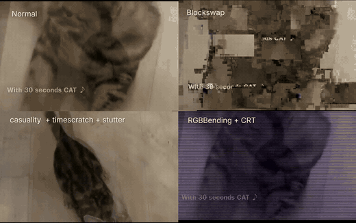

<h1 align="center">effex</h1>

<p align="center"><b>video effects that break and distort themselves</b></p>

<p align="center">
  <a href="https://github.com/kaffeindecaf/effex/actions/workflows/tests.yml"></a>
  
  
  
</p>

<p align="center">
  pick a clip, chain effects, render it. a terminal menu for mangling video with
  ffmpeg, plus a scriptable cli that does the same thing.
</p>

<p align="center">
  <a href="#quick-start">quick start</a> &nbsp;·&nbsp;
  <a href="#the-menu">the menu</a> &nbsp;·&nbsp;
  <a href="#effects">effects</a> &nbsp;·&nbsp;
  <a href="#cli">cli</a> &nbsp;·&nbsp;
  <a href="#install">install</a> &nbsp;·&nbsp;
  <a href="#when-something-breaks">when something breaks</a>
</p>

<p align="center">
  <a href="catcomparison.mp4"></a>
</p>

> one cat clip, four renders: **normal**, **blockswap**,
> **causality + timescratch + stutter**, **rgb bending + crt**.
> [watch the full comparison (17 s mp4)](catcomparison.mp4) - every panel is a
> single effex run on the same source.

## quick start

drop clips in `input/`, then run `./effex.py` from the project folder and pick
the clip, the effect and its options. `p` previews a single-pass effect before
you commit to a render; `ctrl+c` cancels one mid-way and removes the partial
file.

```sh
git clone https://github.com/kaffeindecaf/effex
cd effex
./effex.py                 # linux, macos
effex.cmd                  # windows
```

the first launch checks the requirements and offers to install ffmpeg for you -
answer `y` and it uses the package manager it finds on your system. see
[install](#install) for the manual route.

## the menu

| key | does |
| --- | --- |
| `up` `down` | move through the list |
| `enter` | pick the highlighted row |
| `left` `right` | change a value in place |
| `space` | chip an effect onto the chain (chip 1, 2, 3 = run order) |
| `c` | clear the chain in the effect picker |
| `1`-`9` | quick-pick an effect |
| `[` `]` | jump between effect groups |
| `p` | preview a single-pass effect |
| `r` | render, or rescan `input/` in the video picker |
| `o` | open the output folder |
| `l` | open the log folder, on the failure screen |
| `q` | back one screen, or quit from the main menu |
| `?` | help screen |

the render screen shows the active effect, a readable pipeline, frame progress,
elapsed time, speed and an estimated finish.

## effects

25 effects, grouped the way the picker groups them. every one keeps the source
frame size and audio unless its own section says otherwise.

| effect | what it does | chains |
| --- | --- | --- |
| `stretch` | squash the frame into another shape | yes |
| `pixelize` | turn the picture into fat blocks | yes |
| `zoom` | creep slowly into the frame | yes |
| `wobble` | rock the frame side to side | yes |
| `spin` | spin the whole frame | yes |
| `stutter` | chop the frame rate down | yes |
| `slowmo` | speed the clip up or down, audio pitches with it | yes |
| [`collapse`](#content-aware-elastic-collapse) | progressive content-aware scale, optional pixel mosh | yes |
| `rgbsplit` | drift the color planes apart | yes |
| `deepfry` | saturate and crunch it to death | yes |
| `posterize` | crush the colors into bands | yes |
| `channelswap` | circuit-bent rgb - channels trade places | yes |
| `vhs` | tape grain, color bleed, tracking tears | yes |
| `crt` | scanlines, fuzz and a slow roll | yes |
| [`lobotomy`](#channel-lobotomy) | crush, kill and swap individual color channels | yes |
| [`neon`](#neon-hue-cycle) | swing through saturated acid colors with a contrast punch | yes |
| `trails` | frames bleed into each other | yes |
| `timescratch` | drag the timeline cursor - forward, backward, slow, fast | own pipeline |
| `sediment` | deposit frames into bounded, decaying visual history | yes |
| `dropout` | frames vanish at random - the picture holds | yes |
| [`inversion`](#causality-inversion) | borrow real pixels from buffered future frames | yes |
| [`archaeology`](#pixel-archaeology) | borrow a cutout from the future, then melt it away | yes |
| [`datamosh`](#heavy-datamosh) | codec-level melt - the decoder smears the motion | own pipeline |
| [`blockswap`](#blockswap) | blocks trade places, teleport on a timer, optional mosh | own pipeline |
| `crunch` | turn the bitrate and resolution down | yes |

### shape and motion

<details>
<summary><b>stretch</b> - squash the frame into another shape</summary>

| option | meaning | default | range |
| --- | --- | --- | --- |
| `target` | shape of the frame | 9:16 | `9:16`, `16:9`, `4:5`, `1:1`, `3:4`, `custom` |
| `resample` | how pixels blend when scaling | bicubic | `bicubic`, `bilinear`, `neighbor`, `lanczos`, `spline` |
| `rotation` | strip phone rotation from the file | on | on, off |
| `flip` | mirror the frame after the squash | none | `none`, `h`, `v`, `hv` |

```sh
./effex.py stretch input/clip.mp4
```

</details>

<details>
<summary><b>pixelize</b> - turn the picture into fat blocks</summary>

| option | meaning | default | range |
| --- | --- | --- | --- |
| `chunk` | bigger = chunkier, in pixels per block | 24 | 2-128 |
| `edges` | block edges: crisp pixels or soft blur | crisp | `crisp`, `soft` |
| `shape` | shape of the frame | keep | `keep`, `9:16`, `16:9`, `4:5`, `1:1`, `3:4`, `custom` |

```sh
./effex.py pixelize input/clip.mp4
```

</details>

<details>
<summary><b>zoom</b> - creep slowly into the frame</summary>

| option | meaning | default | range |
| --- | --- | --- | --- |
| `zoom` | how far in it creeps (percent of the frame) | 135 | 110-300 |
| `speed` | how fast it creeps | slow | `slow`, `fast` |

```sh
./effex.py zoom input/clip.mp4
```

</details>

<details>
<summary><b>wobble</b> - rock the frame side to side</summary>

| option | meaning | default | range |
| --- | --- | --- | --- |
| `amount` | how far the frame rocks, in degrees | 4 | 1-15 |
| `speed` | how fast it rocks | slow | `slow`, `medium`, `fast` |
| `waveform` | the shape of the rock | sine | `sine`, `triangle` |

```sh
./effex.py wobble input/clip.mp4
```

</details>

<details>
<summary><b>spin</b> - spin the whole frame</summary>

| option | meaning | default | range |
| --- | --- | --- | --- |
| `period` | time for one full rotation | 6.0 | 0.5-30.0 |
| `direction` | which way it turns | clockwise | `clockwise`, `counterclockwise` |

```sh
./effex.py spin input/clip.mp4
```

</details>

<details>
<summary><b>stutter</b> - chop the frame rate down</summary>

| option | meaning | default | range |
| --- | --- | --- | --- |
| `fps` | how choppy the motion gets | 8 | `8`, `12`, `15` |
| `mode` | how the gap is filled | drop | `drop`, `hold` |

```sh
./effex.py stutter input/clip.mp4
```

</details>

<details>
<summary><b>slow + pitch</b> - speed the clip up or down, audio pitches with it</summary>

| option | meaning | default | range |
| --- | --- | --- | --- |
| `factor` | how slow or fast it plays | 0.5 | `0.25`, `0.5`, `2`, `4` |

```sh
./effex.py slowmo input/clip.mp4
```

</details>

#### content-aware elastic collapse

`collapse` lives under **SHAPE & MOTION**. The default `seam` mode behaves like
Photoshop content-aware scaling: each frame starts at its original composition,
then its content-aware shrink grows linearly from the first frame to the clip's
end. Low-energy seams are removed from a reduced analysis frame. The renderer
inverts that seam-removal displacement so the content shrinks, then maps it to
the original canvas dimensions. High-gradient regions resist shrinking.
Analysis is capped at 192 pixels on the longest side and updates at most five
times per second; the displacement field is smoothed between updates.
`mode=elastic` keeps the earlier seeded, spatially nonuniform elastic warp.
Pixelation is a separate switch and is **off by default**: the render is the
smooth warped frame at source resolution. Set `pixelate=on` to finish with a
reduced-resolution grid enlarged using nearest neighbors, and optionally let
moving regions borrow a limited blend of the previous frame's blocks for a
codec-mosh-like trail. The effect never modifies codec packets.

| option | range / values | default |
| --- | --- | --- |
| `intensity` | 0-100%, overall scale strength (elastic warp strength in elastic mode) | 100% |
| `horizontal` | 0-100%, share of the maximum width shrink / horizontal warp | 100% |
| `vertical` | 0-100%, share of the maximum height shrink / vertical warp | 100% |
| `preserve` | 0-100%, content/edge protection | 75% |
| `mode` | seam, elastic | seam |
| `seam_strength` | 0-100%, maximum content-aware shrink by clip end | 100% |
| `motion` | 0-100%, elastic motion influence | 50% |
| `smoothness` | 0-100%, spatial field smoothness | 70% |
| `speed` | 0-4 elastic cycles per second | 0.35 |
| `coherence` | 0-100%, elapsed-time field smoothing | 80% |
| `seed` | 0-2147483647; elastic mode only, 0 derives phases from the source | 0 |
| `pixelate` | on, off - finish with chunky pixel blocks | off |
| `block_size` | 1-16 reduced-grid cells when `pixelate=on`; larger means chunkier | 4 |
| `mosh` | 0-100%, previous-block carry when `pixelate=on` (up to 50% mix) | 60% |

In seam mode, shrink is capped at 50% per axis. The target reduction is
`50% × intensity × seam_strength × horizontal/vertical control`; `preserve`
steers seams away from strong edges. The final displacement is multiplied by
elapsed clip progress, producing a linear ramp while each output frame remains
at source dimensions. `smoothness` and `coherence` steady the reduced-resolution
seam map; motion, speed, and random phases apply only to elastic mode.

Zero intensity is an exact passthrough; two zero axis scales disable both modes.
`block_size` and `mosh` do nothing while `pixelate=off`; the smooth remap is the
default look.
Zero seam strength disables seam mode. Seam geometry starts at identity and
reaches its configured scale at clip end.
State resets on a new input/shape, explicit reset, rewind, frame discontinuity,
explicit scene cut, or a large RGB scene change. Persistent analysis state is
bounded independently of clip length; full-frame remap buffers are transient.
Chains such as `neon+collapse+sediment+deepfry` reuse the shared decoder,
encoder, audio handling, progress, cancellation and partial-file cleanup.

Benchmark both modes, with and without pixelation (requires the optional
dependencies):

```sh
python3 tests/benchmark_collapse.py --frames 60 --output benchmarks/collapse.json
python3 tests/benchmark_collapse.py --frames 60 --pixelate on --output benchmarks/collapse-pixelated.json
```

The report measures processor frame time and peak process RSS at 640x360 and
1280x720 in fresh workers. It excludes FFmpeg decode/encode and is not an
end-to-end playback guarantee. Seam mode also reports carving-update time.

Recorded on this Linux x86_64 host with one OpenCV CPU thread, 60 frames per
case, Python 3.13.5, NumPy 2.2.4 and OpenCV 4.12.0 (raw data in
`benchmarks/collapse.json` and `benchmarks/collapse-pixelated.json`):

| mode | pixelate | frame size | mean ms/frame | p95 ms/frame | peak process RSS |
| --- | --- | --- | --- | --- | --- |
| elastic | off | 640x360 | 4.41 | 4.55 | 64.5 MiB |
| elastic | off | 1280x720 | 10.51 | 10.74 | 109.8 MiB |
| seam | off | 640x360 | 16.71 | 89.15 | 63.6 MiB |
| seam | off | 1280x720 | 26.34 | 114.34 | 110.2 MiB |
| elastic | on | 640x360 | 4.53 | 4.63 | 64.9 MiB |
| elastic | on | 1280x720 | 11.90 | 12.15 | 110.1 MiB |
| seam | on | 640x360 | 22.30 | 122.10 | 63.4 MiB |
| seam | on | 1280x720 | 28.22 | 114.30 | 110.2 MiB |

Seam averages include frames reusing a cached map, so p95 is dominated by the
carving update. Skipping pixelation removes the extra downsample/upsample pass
(about 5 ms mean in seam mode here) and is the default. These are measurements
of this fixture on this host, not a promise for every input.

### color and texture

<details>
<summary><b>rgb split</b> - drift the color planes apart</summary>

| option | meaning | default | range |
| --- | --- | --- | --- |
| `amount` | how far the color planes drift (chroma steps) | 12 | 2-80 |
| `axis` | which way the planes drift | horizontal | `horizontal`, `vertical` |
| `channels` | which planes drift (pick several) | ['r', 'b'] | `r`, `b` |

```sh
./effex.py rgbsplit input/clip.mp4
```

</details>

<details>
<summary><b>deepfry</b> - saturate and crunch it to death</summary>

| option | meaning | default | range |
| --- | --- | --- | --- |
| `strength` | how fried (saturation, contrast, crunch) | 40 | 10-100% |
| `brightness` | lift or crush the exposure | 0 | -30-30 |
| `crisp` | how crunchy the sharpening gets | 20 | 0-20 |

```sh
./effex.py deepfry input/clip.mp4
```

</details>

<details>
<summary><b>posterize</b> - crush the colors into bands</summary>

| option | meaning | default | range |
| --- | --- | --- | --- |
| `levels` | fewer = harsher color bands | 8 | `2`, `4`, `8`, `16` |
| `grain` | sprinkle noise to break up the bands | off | on, off |

```sh
./effex.py posterize input/clip.mp4
```

</details>

<details>
<summary><b>channelswap</b> - circuit-bent rgb - channels trade places</summary>

| option | meaning | default | range |
| --- | --- | --- | --- |
| `swap` | which channels trade places | rb | `rb`, `gb`, `rg`, `roll`, `invert` |
| `bleed` | how far the color smears sideways | 0 | 0-30 |

```sh
./effex.py channelswap input/clip.mp4
```

</details>

<details>
<summary><b>vhs</b> - tape grain, color bleed, tracking tears</summary>

| option | meaning | default | range |
| --- | --- | --- | --- |
| `bleed` | how far the color smears sideways | 4 | 0-40 |
| `noise` | how much tape grain | 14 | 0-60 |
| `tracking` | vertical roll tears, in pixels | 12 | 0-40 |
| `fade` | wash the colors out like an old tape | on | on, off |

```sh
./effex.py vhs input/clip.mp4
```

</details>

<details>
<summary><b>crt</b> - scanlines, fuzz and a slow roll</summary>

| option | meaning | default | range |
| --- | --- | --- | --- |
| `lines` | dark lines across the screen | on | on, off |
| `curve` | bulge the screen like a tube | off | on, off |
| `noise` | how much electric fuzz | 6 | 0-30 |
| `roll` | a slow vertical crawl, in pixels | 0 | 0-30 |

```sh
./effex.py crt input/clip.mp4
```

</details>

#### channel lobotomy

`lobotomy` crushes each RGB channel independently, removes an optional source
channel, then swaps the survivors. Find it under **COLOR & TEXTURE** in the menu.

| option | values | default |
| --- | --- | --- |
| `red` | 2, 4, 8, 16, 32, 64, 128, 256 levels | 8 |
| `green` | same level choices | 4 |
| `blue` | same level choices | 8 |
| `kill` | none, r, g, b | g |
| `swap` | none, rb, rg, gb, roll | rb |

The filter order is `format=rgb24,lutrgb,colorchannelmixer,colorchannelmixer`:
quantization uses `floor(val/Q)*Q` with `Q=256/levels`; kill happens **before**
swap, so killing red and swapping red/blue leaves the output blue channel empty.
Set all three levels to 256 with `kill=none` and `swap=none` for unchanged colors.

#### neon hue cycle

`neon` swings the hue back and forth, boosts saturation, and punches contrast
with an S-curve. It is also under **COLOR & TEXTURE**.

| option | range | default |
| --- | --- | --- |
| `amount` | 0-180 degrees of hue swing | 120 |
| `period` | 0.5-30 seconds per full cycle | 4 |
| `saturation` | 100-300% | 200% |
| `punch` | 0-100% curve strength | 50% |

The filter is `hue=h='A*sin(2*PI*t/P)':s=S,curves=all='...'`.
`h` uses degrees, not radians. Saturation at 100% is unchanged; punch at 0%
disables the curve. Set `amount=0`, `saturation=100` and `punch=0` to disable
the whole effect. Both effects preserve frame size and audio, support `p`
previews, and chain in either order without extra dependencies.

### time and memory

<details>
<summary><b>trails</b> - frames bleed into each other</summary>

| option | meaning | default | range |
| --- | --- | --- | --- |
| `trail` | how many frames bleed into each other | 10 | 2-20 |
| `mode` | even blend or a fading tail | fade | `fade`, `even` |

```sh
./effex.py trails input/clip.mp4
```

</details>

<details>
<summary><b>timescratch</b> - drag the timeline cursor - forward, backward, slow, fast</summary>

| option | meaning | default | range |
| --- | --- | --- | --- |
| `curve` | the math that generates the scratches | sine | `sine`, `random`, `swing`, `walk` |
| `speed` | how wild the speeds get | rough | `gentle`, `rough`, `extreme` |
| `cuts` | how many scratches across the clip | medium | `light`, `medium`, `heavy` |

```sh
./effex.py timescratch input/clip.mp4
```

</details>

<details>
<summary><b>temporal sediment</b> - deposit frames into bounded, decaying visual history</summary>

| option | meaning | default | range |
| --- | --- | --- | --- |
| `intensity` | how much accumulated history shows | 65 | 0-100% |
| `deposit` | how strongly new frames enter history | 70 | 0-100% |
| `decay` | how quickly old layers fade | 35 | 0-100% |
| `layers` | number of decay speeds to retain | 3 | `1`, `2`, `3` |
| `motion` | how strongly movement deposits pixels | 50 | 0-100% |
| `excavation` | chance per frame to reveal an older patch | 5 | 0-100% |
| `excavation_size` | patch width and height as a frame percent | 15 | 5-50% |
| `color` | how stored colors are treated | keep | `keep`, `warm`, `cool`, `mono` |
| `seed` | 0 derives a repeatable seed from the clip | 0 | 0-2147483647 |

```sh
./effex.py sediment input/clip.mp4
```

</details>

<details>
<summary><b>dropout</b> - frames vanish at random - the picture holds</summary>

| option | meaning | default | range |
| --- | --- | --- | --- |
| `chance` | percent of frames that vanish | 8 | 1-50 |

```sh
./effex.py dropout input/clip.mp4
```

</details>

#### causality inversion

`inversion` is under **TIME & MEMORY**. Selected regions borrow actual pixels
from a later decoded frame. It never predicts or fabricates future content.

| option | range / values | default |
| --- | --- | --- |
| `lookahead` | 0-5 seconds of buffer horizon | 0.5 |
| `offset` | 0-lookahead seconds into the future | 0.5 |
| `strength` | 0-100%, opacity or replacement coverage | 65% |
| `mode` | blend, replace, tear, align | blend |
| `region` | full, bands, blocks, patch | full |
| `mask_speed` | 0-4 mask/tear cycles per second | 0.25 |
| `alignment` | 0-100%, flow gain in align mode | 100% |
| `feather` | 0-100%, region edge softness | 10% |
| `seed` | 0-2147483647; 0 derives masks from source | 0 |

Blend mixes current and future RGB values. Replace uses strength as seeded
patch coverage, so half strength replaces some pixels rather than making all
pixels half-transparent. Tear shifts horizontal bands from the future image.
Align estimates reduced-resolution forward flow and samples the future image
at those coordinates to bring it toward the current scene. All modes can use
the same region masks and feathering; alignment only affects `mode=align`.

The buffer adds up to `lookahead` seconds of video processing delay, plus one
decoded frame used to determine packet duration. Output timestamps do not move.
Live input cannot provide genuine future pixels without that buffering; the
current CLI accepts files, not live streams. A future request uses the first
available frame at or after the target time. Near EOF, or before a detected
scene cut, it clamps to the latest available frame in that segment. The final
frame therefore stays unchanged. Zero strength or zero offset passes through
without keeping a look-ahead queue.

Each inversion queue is capped at 128 frames and 128 MiB of persistent state.
Transient RGB/float masks, alignment maps and encoder buffers are additional;
the cap is not a limit on total process RSS.
High-resolution/high-rate inputs automatically shorten the effective look-ahead
and offset to fit that budget, rather than refusing to render. The nominal limit
is `(buffer capacity - 1) / fps`; requested settings are preserved. The completion
screen, plain output and JSON `warnings` report any reduction. At 2560x1440/30 fps,
the default 0.5-second request becomes about 0.367 seconds. Resize before inversion
to retain a longer horizon. A frame larger than the entire budget still requires
resizing; a one-frame capacity becomes passthrough with a warning.
An unusually dense VFR burst can fill the queue; its oldest frame then
uses the latest already-buffered future instead of exceeding the cap. Explicit
reset, rewind, frame discontinuity or a new clip clears pending state. Scene
cuts drain the old segment before starting the next, preventing future-scene
pixels from leaking backward across cuts.

The shared renderer keeps original rational video PTS through NUT RGB pipes,
including chains with sediment or collapse in either adjacent order. Unfiltered
AAC/MP3/AC3/EAC3/ALAC/Opus audio is stream-copied to avoid encoder priming shifts.
Other audio codecs or chains with audio filters are encoded to AAC; encoder
delay can apply. Temporal FFmpeg filters such as slowmo still deliberately
change timestamps. Masks/flow use seconds for analysis; exported PTS stays exact.

Tests cover early object appearance, mode differences, EOF/short/static clips,
scene boundaries, resets, bounded queues, caller ownership, VFR/nonzero-start
timestamps, copied audio packets, short pipe writes, cancellation and cleanup.
Run `python3 tests/run_tests.py inversion` for the focused suite.

`python3 tests/benchmark_inversion.py --frames 60 --output benchmarks/inversion.json`
records each mode at 640x360 and 1280x720 in fresh workers. With a 0.5-second
horizon at 30 fps, measured queue state was about 9.89 MiB at 360p and 39.55 MiB
at 720p. At 720p, processor-only averages including EOF drain were 11.93 ms
blend, 15.10 ms replace, 24.32 ms tear and 23.10 ms align. These exclude
FFmpeg decode/encode and are not end-to-end real-time claims. The JSON records
peak process RSS separately from bounded processor state.

#### pixel archaeology

`archaeology` (under **TIME & MEMORY**) borrows a cutout from a *future* frame,
holds it in the present picture, then melts it back into the video. Nothing is
synthesised: every borrowed pixel is a copy of a frame that has not been shown
yet, so the picture briefly shows something that has not happened.

The mental model is a sky of drifting clouds. Somewhere in the frame a region of
cloud sits that looks like the same kind of cloud a fraction of a second later,
but the cloud has moved. Archaeology cuts that later cloud out, pastes it into
the present frame under a soft, grown mask, lets it drift with its own motion,
then dissolves it - blotch by blotch, with a flow-warped smudge - until the live
frame is back.

```sh
./effex.py archaeology input/clip.mp4
./effex.py archaeology input/clip.mp4 --set gap=30 --set size=24 --set pick=dissimilar
./effex.py archaeology input/clip.mp4 --set mode=slide --set hold=10 --set melt=24
./effex.py neon+archaeology+deepfry input/clip.mp4 --set archaeology.gap=12
./effex.py archaeology input/clip.mp4 --set seam=none --set feather=0 --set shape=rect
```

| option | range / values | default |
| --- | --- | --- |
| `lookahead` | 0.1-2.0 s of frames buffered ahead (also the output delay) | 0.6 |
| `gap` | 1-60 frames ahead the cutout is taken from | 18 |
| `cutouts` | 1-3 simultaneous cutouts | 1 |
| `spawn_every` | 4-120 frames between spawns | 24 |
| `size` | 5-40% of the frame the cutout aims to cover | 18% |
| `pick` | coherent, dissimilar, random | coherent |
| `min_motion` | 0-30%, ignore slower regions | 2% |
| `max_motion` | 1-100%, ignore faster regions | 25% |
| `similarity` | 0-100%, how close a surface must look to count as a match | 60% |
| `shape` | blob, rect | blob |
| `seam` | poisson, none | poisson |
| `feather` | 0-100%, edge softness (scaled to the blob, not the frame) | 35% |
| `hold` | 1-30 frames the cutout stays sharp | 6 |
| `melt` | 2-60 frames it takes to dissolve | 14 |
| `mode` | smudge, slide | smudge |
| `retention` | 0-95%, how much smeared detail each melt frame keeps | 70% |
| `drift` | 0-100%, how far the cutout follows its own motion | 100% |
| `seed` | 0-2147483647, 0 derives repeatable timing from the clip | 0 |

Selection is what makes or breaks the look, so it is worth knowing what the
knobs do. Every spawn tiles the frame at analysis scale (longest side <= 160 px),
rejects flat tiles, and measures two things per tile: how similar the surface is
to the same spot a `gap` frames later, and how much the pixels actually differ
there. A cutout is only eligible when the surface is similar (`similarity`) *and*
the future really differs at that spot - borrowing from a region that looks
identical ahead produces an invisible cutout, which is the old failure mode.
`coherent` then prefers the strongest visible difference inside the motion window
(`min_motion`..`max_motion`), `dissimilar` takes the least matching surface under
a cap, and `random` is the unweighted baseline.

The chosen seed tile grows into one blob by region growing on descriptor
distance, relaxing the budget in passes and finally dilating so the area tracks
`size`; morphology rounds it and a blob-scaled blur feathers the border. With
`seam=poisson` and headless OpenCV the sharp hold frames are merged with
`cv2.seamlessClone` (`NORMAL_CLONE`), otherwise a feathered alpha blend is used -
`seam=none` gives exact future pixels with a hard-ish edge, which is what the
provenance tests assert.

`mode=smudge` keeps an accumulator per cutout, `acc = warp(acc, flow) * retention
+ future * (1 - retention)`, so melting detail is warped along the region's own
motion and composited through the decaying mask; opacity eases out as the
blotches open, otherwise the tail of the melt eats the live picture. `mode=slide`
skips the accumulator and dissolves the mask with a low-frequency noise
threshold, which is cheaper and reads as a clean dissolve rather than a smear.
After `hold + melt` frames the cutout is gone and the emitted frame is the live
frame, bit-identical.

The future frames are real: the processor buffers `ceil(lookahead * fps) + 1`
frames (at most 128, and never more than the 128 MiB budget) and emits every
packet with its original index, timestamp and duration. A spawn is skipped when
no real future frame exists at the gap distance (near the end of the clip), and
the remainder is drained at EOF. Look-ahead is the only latency in the effect and
it is dropped from the output timeline, not stretched. State resets on explicit
or detected scene cuts, timestamp rewind and frame-index discontinuity, and is
bounded independently of clip length.

This effect is CPU-bound and needs NumPy (`requirements-stateful.txt`); poisson
seams and DIS optical flow need headless OpenCV (`requirements-collapse.txt`),
and without it the flow falls back to numpy block matching with a runtime note.
It has no stateful preview; it does keep original rational timestamps because it
uses the timestamped transport, so chaining with `inversion` preserves VFR input.
Benchmark the processor alone with:

```sh
python3 tests/benchmark_futurecut.py --frames 90 --output benchmarks/futurecut.json
```

Processor-only timings on this Linux x86_64 host (fresh worker per case, 90
frames, excludes FFmpeg decode/encode and is not an end-to-end claim):

| mode | 640x360 mean / p95 | 1280x720 mean / p95 | 1920x1080 mean / p95 | peak state |
| --- | --- | --- | --- | --- |
| smudge | 6.02 / 15.75 ms | 22.54 / 80.75 ms | 36.45 / 69.50 ms | 122.6 MiB |
| slide | 4.18 / 10.75 ms | 18.04 / 76.08 ms | 27.27 / 49.47 ms | 116.7 MiB |

The p95 spikes are spawn frames (region growing plus the first smudge frame).
Peak state is the buffered look-ahead plus one accumulator per live cutout, and
the buffer is what limits resolution: the 128 MiB budget fits 18 frames at
1080p and 8 at 1440p, so a long `lookahead` is clamped there with a runtime
warning instead of growing without bound. End to end, a 2560x1440 clip renders
at roughly 160 ms/frame including decode and encode.

### codec and blocks

<details>
<summary><b>crunch</b> - turn the bitrate and resolution down</summary>

| option | meaning | default | range |
| --- | --- | --- | --- |
| `res` | how far to shrink the picture | 100 | `100`, `75`, `50`, `25` |
| `bitrate` | how much data the video gets, in kbit/s | 800 | 100-5000 |

```sh
./effex.py crunch input/clip.mp4
```

</details>

#### heavy datamosh

`datamosh` lives under **CODEC & BLOCKS**. Heavy is now the default: remove
recovery keyframes, crush the MPEG-4 encode, and repeatedly apply short runs of
P-frame motion/residual data to stale pixels. This is codec-level blooming,
not a pixel overlay or a repeated decoded still frame.

```sh
./effex.py datamosh input/a.mp4 --with input/b.mp4
./effex.py datamosh input/a.mp4 --with input/b.mp4 --set preset=heavy --set bloom=24 --set bloom_window=1
./effex.py datamosh input/a.mp4 --set preset=standard
./effex.py datamosh input/a.mp4 --with input/b.mp4 --set second_start=2 --set second_length=3 --set audio=mix
```

| setting | heavy (default) | standard |
| --- | --- | --- |
| `cut` | heavy: remove recovery keyframes | heavy |
| `fill` | chaos: seeded random motion frame | next motion frame |
| `hold` | 12-frame keyframe interval | 150 frames |
| `grit` | 18, visibly crushed | 2, cleaner |
| `bloom` | reuse motion across 12 frame slots | 1, disabled |
| `bloom_window` | cycle 2 captured motion frames per burst | 1 |

`bloom` ranges from 1-60 slots, and `bloom_window` from 1-12 motion frames
(capped to the burst length). Longer bursts and smaller windows sustain the
same motion for longer. Individual `--set` knobs override the chosen preset
regardless of argument order. `--set preset=...` is the **mosh** preset;
`--preset` remains the unrelated x264 encoder option.

In the menu, **second video** is the first row and **mosh preset** is the second.
Changing the preset loads its codec knobs; they remain editable afterward.
The options scroll on short terminals. `--set second=path` still works, while
two positional files still mean two separate batch renders. Use `--with` for
one combined video.

The second clip is appended, resized/padded and frame-rate-normalized to match
the first. Its boundary keyframe is removed when compatible, so its motion
inherits the first clip's stale image instead of making a clean cut. The result
is sequential, not a simultaneous opacity blend. `audio=auto` joins audio with
silence for missing tracks; `first`, `second`, `mix` and `none` remain available.

Bloom replaces existing frame slots rather than inserting frames, preserving
the normalized timeline and audio length. Reused VOPs take the destination
timestamp; incompatible clock-header lengths keep the original slot so internal
slice markers cannot shift. A recovery keyframe can survive that safety fallback.
Very short/static inputs with little prediction data may show less melting.
The intermediate compressed stream is edited in memory, so memory use scales
with clip size. No extra packages or custom FFmpeg build are required.

Technique references: [tomato's bloom/pulse modes](https://github.com/GlitchTools/tomato),
[tiberiuiancu/datamoshing's P-frame reuse](https://github.com/tiberiuiancu/datamoshing),
and [python-moshion's two-source splice](https://github.com/rjmoggach/python-moshion).
Effex implements these techniques independently; no repository code is vendored.

#### blockswap

`blockswap` under **CODEC & BLOCKS** swaps rectangular regions of the frame
between seeded positions. The blocks do not slide: each layout holds until it
teleports.

```sh
./effex.py blockswap input/clip.mp4
./effex.py blockswap input/clip.mp4 --set blocks=5 --set size=15 --set teleport=2
./effex.py blockswap input/clip.mp4 --set teleport=1 --set mosh=25
./effex.py blockswap input/clip.mp4 --set seed=17 --set mosh=70 --set mosh_grit=20
```

| option | range | default | meaning |
| --- | --- | --- | --- |
| `size` | 5-60% | 20% | block width and height as a share of the frame |
| `blocks` | 1-8 | 3 | swapped block pairs (each pair relocates two regions) |
| `teleport` | 0-30 s | 3 | seconds per layout; 0 keeps one layout for the whole clip |
| `mosh` | 0-100% | 0 | light codec datamosh over the whole clip; 0 disables |
| `mosh_grit` | 1-31 | 12 | crunch of the intermediate mpeg4 encode |
| `mosh_hold` | 2-600 | 12 | keyframe interval in the intermediate encode |
| `seed` | 0-2147483647 | 0 | 0 derives a repeatable layout from the clip |

Each teleport window gets its own seeded layout, emitted as a `swaprect` filter
with an `enable='between(t,...)'` guard, so several layouts coexist in one
command. Windows are capped (`48 / blocks`) so a long clip cannot explode into
hundreds of filters. Blocks inside one window are kept from overlapping.

`mosh` turns blockswap into a two-pass codec render: the swaprect chain is
encoded to mpeg4 with `mosh_grit`/`mosh_hold`, recovery keyframes are removed by
survival `100 - mosh`, motion data is bloomed over `mosh/12` frame slots, and the
result is remuxed with the source audio. Teleports land in that stream as hard
prediction breaks, so the blocks themselves smear - which is the point. Higher
`mosh` keeps fewer keyframes and blooms more. Because it edits the bitstream,
blockswap cannot be chained with other effects and has no preview; with
`mosh=0` it is still encoded in a single pass (same filters, normal libx264).

## chains

single-pass effects stack with `+`, and order matters: `stretch+deepfry` is not
`deepfry+stretch`.

```sh
./effex.py stretch+deepfry input/clip.mp4 --set deepfry.strength=60
./effex.py lobotomy+neon input/clip.mp4 --set lobotomy.kill=g --set neon.period=2
./effex.py neon+archaeology+deepfry input/clip.mp4 --set archaeology.gap=12
```

`datamosh`, `timescratch` and `blockswap` edit the codec stream, so they run
their own multi-pass pipeline and cannot be chained. stateful processors
(`sediment`, `collapse`, `inversion`, `archaeology`) can sit before or after
ordinary filters, but several of them must stay adjacent. stateful previews are
not available.

temporal sediment keeps a bounded 128 MiB history buffer. without inversion,
stateful chains normalize input to the probed frame rate; a chain containing
inversion carries the original rational timestamps instead, so variable-rate
input and nonzero start times survive.

## cli

```sh
./effex.py --list                                  # every effect and its options
./effex.py --check                                 # requirements, exit 1 if short
./effex.py stretch input/clip.mp4 --set target=16:9
./effex.py datamosh input/a.mp4 --with input/b.mp4
./effex.py collapse input/clip.mp4 --set pixelate=on --set block_size=5
./effex.py stretch input/clip.mp4 --dry-run        # print the ffmpeg command only
```

| flag | does |
| --- | --- |
| `--list [--json]` | list effects, options and the videos in `input/` |
| `--check [--json]` | requirements check, json for scripts |
| `--set key=value` | set an effect option, repeatable |
| `--with VIDEO` | mash a second clip into datamosh |
| `--size WxH` | shorthand for `--set target=WxH` |
| `--output PATH` | exact output path, single file only |
| `--force` | overwrite instead of adding `_2`, `_3` |
| `--dry-run` | print the planned ffmpeg command, render nothing |
| `--json` | machine readable result |
| `--crf`, `--preset` | x264 quality and speed (default 18, medium) |
| `--suffix` | output name suffix |
| `--input-dir`, `--output-dir` | folders; `EFFEX_INPUT_DIR` / `EFFEX_OUTPUT_DIR` too |
| `--logs`, `--report` | print the diagnostics log, or write an issue report |
| `--quiet`, `--no-color` | less output, no ansi |

without `--force` an existing render is never replaced: effex adds `_2`, `_3` and
so on. when two chained effects share an option key, prefix it:
`--set deepfry.strength=60`.

```sh
./effex.py --list
./effex.py --check
./effex.py stretch input/clip.mp4 --set target=16:9
./effex.py stretch+deepfry input/clip.mp4 --set deepfry.strength=60
./effex.py lobotomy+neon input/clip.mp4 --set lobotomy.kill=g --set neon.period=2
./effex.py sediment input/clip.mp4 --set intensity=70 --set layers=3 --set excavation=10 --set seed=123
./effex.py sediment+deepfry input/clip.mp4 --set sediment.decay=30 --set sediment.color=warm --set deepfry.strength=60
./effex.py collapse input/clip.mp4
./effex.py collapse input/clip.mp4 --set pixelate=on --set block_size=5 --set mosh=70
./effex.py collapse input/clip.mp4 --set mode=elastic --set seed=17
./effex.py inversion input/clip.mp4 --set lookahead=0.5 --set offset=0.3 --set region=bands
./effex.py datamosh input/a.mp4 --with input/b.mp4
./effex.py archaeology input/clip.mp4 --set metric=texture --set boundary=soft
./effex.py stretch input/clip.mp4 --dry-run
```

`--set key=value` changes an effect option. use `--size 1920x1080` for a shape, `--output path.mp4` for an exact path, and `--force` to overwrite. without `--force`, effex adds `_2`, `_3`, and so on instead of replacing a render.

## install

`effex` checks these on every launch and shows the result in the main menu. when
a required binary is missing it asks `install ffmpeg + ffprobe now?` once and runs
the command for the platform it detected.

| requirement | what it is for | installed with |
| --- | --- | --- |
| `ffmpeg` | renders every effect | the package manager below |
| `ffprobe` | clip details, two-video datamosh, stateful effects | ships in the ffmpeg package |
| python 3.8+ | runs effex | [python.org](https://www.python.org/downloads/) |
| `numpy` (optional) | sediment, collapse, inversion | `requirements-stateful.txt` |
| `opencv` (optional) | elastic collapse seam detail | `requirements-collapse.txt` |
| `PyAV` (optional) | inversion timestamps | `requirements-inversion.txt` |

the installer it picks depends on what is on your PATH:

| os | manager | command |
| --- | --- | --- |
| windows 10/11 | winget | `winget install -e --id Gyan.FFmpeg --accept-package-agreements --accept-source-agreements` |
| windows | chocolatey / scoop | `choco install -y ffmpeg` / `scoop install ffmpeg` |
| macos | homebrew | `brew install ffmpeg` |
| debian, ubuntu, parrot, mint | apt | `sudo apt-get install -y ffmpeg` |
| fedora, rhel | dnf | `sudo dnf install -y ffmpeg` |
| arch, manjaro | pacman | `sudo pacman -S --noconfirm ffmpeg` |
| opensuse | zypper | `sudo zypper install -y ffmpeg` |
| alpine | apk | `sudo apk add ffmpeg` |

answer `n` and the menu keeps the missing count visible; the `requirements` row
(or `c`) asks again. `./effex.py --check` prints the same panel for scripts and
exits 1 when something required is missing; `--check --json` reports `ok`,
`platform`, `installer`, `hint` and one object per requirement.

the optional modules are never installed by that prompt - they are pip packages,
loaded only when rendering stateful effects. ordinary ffmpeg effects and `--list`
still work without them:

```sh
python3 -m pip install -r requirements-stateful.txt
python3 -m pip install -r requirements-collapse.txt
```

causality inversion needs PyAV on top of NumPy, and its aligned mode needs
`requirements-collapse.txt` for cpu optical flow. timestamped export uses
ffmpeg's `-enc_time_base demux` (tested with ffmpeg 7.1).

on systems with an externally managed python, use a local environment:

```sh
python3 -m venv .venv
.venv/bin/python -m pip install -r requirements-collapse.txt -r requirements-inversion.txt
```

on windows the interpreter is `.venv\Scripts\python.exe`. plain `./effex.py`,
`effex.cmd` and installed `effex` launches use the local venv when present; an
already-active environment is respected and `python -S` keeps its no-site
behavior.

to put `effex` on your PATH:

```sh
./install.sh                                          # linux, macos
```

```powershell
powershell -ExecutionPolicy Bypass -File install.ps1   # windows
```

on windows run `effex.cmd` (or `py effex.py`) - `.py` files are not executable
there. the shim prefers `.venv\Scripts\python.exe` and falls back to `py -3`.

## when something breaks

effex keeps a diagnostics log with every warning and error, plus the ffmpeg
stderr that caused a failed render and the traceback of anything that crashed.
a run that works writes nothing, so the file only holds the interesting bits.

| os | log file |
| --- | --- |
| linux | `$XDG_STATE_HOME/effex/logs/effex.log` (`~/.local/state/effex/logs`) |
| macos | `~/Library/Logs/effex/effex.log` |
| windows | `%LOCALAPPDATA%\effex\logs\effex.log` |

`EFFEX_LOG_DIR` points it somewhere else. the file rotates at 512 KiB and keeps
five old copies (`effex.log.1` ... `.5`), so it never grows without bound.

```sh
./effex.py --logs              # print the path and the last 40 lines
./effex.py --report            # one file: environment header + the log tail
./effex.py --report issue.log  # same, at a path you choose
```

every log entry is one line (`2026-10-28 16:17:57 error ffmpeg failed (exit 183)`)
with any detail indented under it, so `grep error` and issue searches work. the
header of each run records the command, working directory, os, python, and the
ffmpeg/ffprobe paths and versions - that is usually what a report needs. a failed
render also shows the log path on the completion screen, where `l` opens the log
folder.

to report a bug: run `effex --report`, attach the file it writes to
<https://github.com/kaffeindecaf/effex/issues/new>. skim it first - it contains
your paths and file names.

## development

| file | holds |
| --- | --- |
| `effex.py` | effect registry, cli, menu, ffmpeg planning, encoding, progress |
| `stateful_effects.py` | cpu frame processors: sediment, collapse, inversion |
| `future_cut.py` | pixel archaeology, a buffered look-ahead stage |
| `datamosh_stream.py` | codec stream surgery: vop parsing and reuse |
| `diagnostics.py` | the log file, rotation and the issue report |
| `frame_pipeline.py`, `timestamped_frames.py` | packet plumbing for buffered stages |
| `tests/` | 15 suites: cli, menu, layout, install, platform, logging, effects |

`input/` holds source clips. `output/` holds renders. Git ignores files in both folders except `.gitkeep`, so clips and renders stay local. Both paths can be changed with `--input-dir` / `--output-dir` or `EFFEX_INPUT_DIR` / `EFFEX_OUTPUT_DIR`.

run the test suite with:

```sh
python3 tests/run_tests.py
python3 tests/run_tests.py psychedelic  # pixel behavior, options and real renders
python3 tests/run_tests.py datamosh mosh-stream  # two sources, presets and codec clocks
python3 tests/run_tests.py collapse seams  # deformation, carving and shared pipeline
python3 tests/run_tests.py inversion  # future pixels, original PTS and EOF fallback
python3 tests/run_tests.py archaeology archaeology-cli  # future-cut provenance and real renders
```

tests use generated clips and temporary folders; they do not overwrite files in `input/` or `output/`.

## credits

built on [ffmpeg](https://ffmpeg.org). the codec techniques were learned from
[tomato](https://github.com/GlitchTools/tomato),
[tiberiuiancu/datamoshing](https://github.com/tiberiuiancu/datamoshing) and
[python-moshion](https://github.com/rjmoggach/python-moshion); effex implements
them independently and vendors none of their code. `catcomparison.mp4` is a demo
asset, not part of the program.
