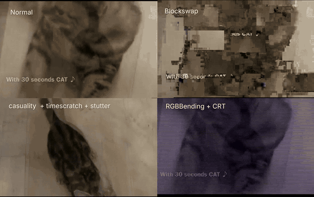
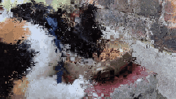
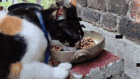
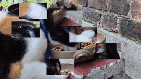
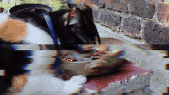
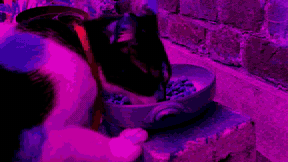
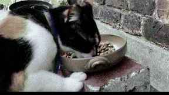
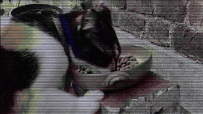

<h1 align="center">effex</h1>

<p align="center"><b>video effects that break and distort themselves</b></p>

<p align="center">
  <a href="https://github.com/kaffeindecaf/effex/actions/workflows/tests.yml"></a>
  
  
  
</p>

<p align="center">
  pick a clip, chain effects, render it. a terminal menu for mangling video with
  ffmpeg, plus a scriptable cli that does the same thing.
</p>

<p align="center">
  <a href="#gallery">gallery</a> &nbsp;·&nbsp;
  <a href="#quick-start">quick start</a> &nbsp;·&nbsp;
  <a href="#effects">effects</a> &nbsp;·&nbsp;
  <a href="#the-menu">the menu</a> &nbsp;·&nbsp;
  <a href="#chains">chains</a> &nbsp;·&nbsp;
  <a href="#cli">cli</a> &nbsp;·&nbsp;
  <a href="#install">install</a> &nbsp;·&nbsp;
  <a href="#when-something-breaks">when something breaks</a> &nbsp;·&nbsp;
  <a href="docs/effects.md">effect reference</a>
</p>

<p align="center">
  <a href="docs/catcomparison.mp4"></a>
</p>

> one cat clip, four renders: **normal**, **blockswap**,
> **causality + timescratch + stutter**, **rgb bending + crt**.
> [watch the full comparison (17 s mp4)](docs/catcomparison.mp4) - every panel is a
> single effex run on the same source.

## gallery

one six-second clip of a calico cat at lunch, eighteen ways. each tile is a
single effex run with default settings unless the command below says otherwise;
click a tile for that effect's options. [watch sixteen of them side by side at
full speed (mp4)](docs/gallery/trompette-grid.mp4).

<table>
  <tr>
    <td align="center"><br><b>original</b></td>
    <td align="center"><a href="docs/effects.md#heavy-datamosh"></a><br><b>datamosh</b></td>
    <td align="center"><a href="docs/effects.md#self-mosh-algorithm"></a><br><b>self-mosh</b></td>
  </tr>
  <tr>
    <td align="center"><a href="docs/effects.md#reverse-infection-algorithm"></a><br><b>reverse infection</b></td>
    <td align="center"><a href="docs/effects.md#flow-mosh"></a><br><b>flow mosh</b></td>
    <td align="center"><a href="docs/effects.md#block-melt"></a><br><b>block melt</b></td>
  </tr>
  <tr>
    <td align="center"><a href="docs/effects.md#bitrot"></a><br><b>bitrot</b></td>
    <td align="center"><a href="docs/effects.md#blockswap"></a><br><b>blockswap</b></td>
    <td align="center"><a href="docs/effects.md#ripple-tank"></a><br><b>ripple tank</b></td>
  </tr>
  <tr>
    <td align="center"><a href="docs/effects.md#raster-slip"></a><br><b>raster slip</b></td>
    <td align="center"><a href="docs/effects.md#causality-inversion"></a><br><b>causality inversion</b></td>
    <td align="center"><a href="docs/effects.md#pixel-archaeology"></a><br><b>pixel archaeology</b></td>
  </tr>
  <tr>
    <td align="center"><a href="docs/effects.md#time-and-memory"></a><br><b>temporal sediment</b></td>
    <td align="center"><a href="docs/effects.md#content-aware-elastic-collapse"></a><br><b>elastic collapse</b></td>
    <td align="center"><a href="docs/effects.md#neon-hue-cycle"></a><br><b>neon hue cycle</b></td>
  </tr>
  <tr>
    <td align="center"><a href="docs/effects.md#channel-lobotomy"></a><br><b>channel lobotomy</b></td>
    <td align="center"><a href="docs/effects.md#color-and-texture"></a><br><b>vhs</b></td>
    <td align="center"><br><b>rgb split + crt</b></td>
  </tr>
</table>

<details>
<summary>the commands behind each tile</summary>

```sh
./effex.py datamosh clip.mp4 --set hold=24
./effex.py datamosh clip.mp4 --set algorithm=self --set cut_length=1.5 --set reverse=50 --set seed=7
./effex.py datamosh clip.mp4 --set algorithm=reverse_infection --set seed=42
./effex.py flowmosh clip.mp4
./effex.py blockmelt clip.mp4
./effex.py bitrot clip.mp4
./effex.py blockswap clip.mp4
./effex.py ripple clip.mp4 --set rain=4
./effex.py rasterslip clip.mp4
./effex.py inversion clip.mp4
./effex.py archaeology clip.mp4
./effex.py sediment clip.mp4
./effex.py collapse clip.mp4
./effex.py neon clip.mp4
./effex.py lobotomy clip.mp4
./effex.py vhs clip.mp4
./effex.py rgbsplit+crt clip.mp4
```

</details>

## quick start

drop clips in `input/`, then run `./effex.py` from the project folder and pick
the clip, the effect and its options. `p` previews a single-pass effect before
you commit to a render; `ctrl+c` cancels one mid-way and removes the partial
file.

```sh
git clone https://github.com/kaffeindecaf/effex
cd effex
./effex.py                 # linux, macos
effex.cmd                  # windows
```

the first launch checks the requirements and offers to install ffmpeg for you -
answer `y` and it uses the package manager it finds on your system. see
[install](#install) for the manual route.

## effects

30 effects in four groups, the same way the menu groups them. every one keeps
the source frame size and audio unless its reference says otherwise. effects
marked `*` run their own multi-pass pipeline and cannot be chained; everything
else stacks with `+`. options, examples and implementation notes for each one
live in the **[effect reference](docs/effects.md)**.

**[shape and motion](docs/effects.md#shape-and-motion)**

| effect | what it does |
| --- | --- |
| [`stretch`](docs/effects.md#shape-and-motion) | squash the frame into another shape |
| [`pixelize`](docs/effects.md#shape-and-motion) | turn the picture into fat blocks |
| [`zoom`](docs/effects.md#shape-and-motion) | creep slowly into the frame |
| [`wobble`](docs/effects.md#shape-and-motion) | rock the frame side to side |
| [`spin`](docs/effects.md#shape-and-motion) | spin the whole frame |
| [`stutter`](docs/effects.md#shape-and-motion) | chop the frame rate down |
| [`slowmo`](docs/effects.md#shape-and-motion) | speed the clip up or down, audio pitches with it |
| [`collapse`](docs/effects.md#content-aware-elastic-collapse) | progressive content-aware scale, optional pixel mosh |
| [`ripple`](docs/effects.md#ripple-tank) | movement splashes into water that bends the picture |

**[color and texture](docs/effects.md#color-and-texture)**

| effect | what it does |
| --- | --- |
| [`rgbsplit`](docs/effects.md#color-and-texture) | drift the color planes apart |
| [`deepfry`](docs/effects.md#color-and-texture) | saturate and crunch it to death |
| [`posterize`](docs/effects.md#color-and-texture) | crush the colors into bands |
| [`channelswap`](docs/effects.md#color-and-texture) | circuit-bent rgb - channels trade places |
| [`vhs`](docs/effects.md#color-and-texture) | tape grain, color bleed, tracking tears |
| [`crt`](docs/effects.md#color-and-texture) | scanlines, fuzz and a slow roll |
| [`lobotomy`](docs/effects.md#channel-lobotomy) | crush, kill and swap individual color channels |
| [`neon`](docs/effects.md#neon-hue-cycle) | swing through saturated acid colors with a contrast punch |

**[time and memory](docs/effects.md#time-and-memory)**

| effect | what it does |
| --- | --- |
| [`trails`](docs/effects.md#time-and-memory) | frames bleed into each other |
| [`timescratch`](docs/effects.md#time-and-memory) | drag the timeline cursor - forward, backward, slow, fast * |
| [`sediment`](docs/effects.md#time-and-memory) | deposit frames into bounded, decaying visual history |
| [`dropout`](docs/effects.md#time-and-memory) | frames vanish at random - the picture holds |
| [`inversion`](docs/effects.md#causality-inversion) | borrow real pixels from buffered future frames |
| [`archaeology`](docs/effects.md#pixel-archaeology) | borrow a cutout from the future, then melt it away |
| [`rasterslip`](docs/effects.md#raster-slip) | travelling scan bands tear sideways through different past moments |

**[codec and blocks](docs/effects.md#codec-and-blocks)**

| effect | what it does |
| --- | --- |
| [`crunch`](docs/effects.md#codec-and-blocks) | turn the bitrate and resolution down |
| [`datamosh`](docs/effects.md#heavy-datamosh) | codec melts, self-mosh, cut shuffle, bloom pulses or reverse infection * |
| [`blockmelt`](docs/effects.md#block-melt) | macroblocks drag the stale picture along the motion |
| [`blockswap`](docs/effects.md#blockswap) | blocks trade places, teleport on a timer, optional mosh * |
| [`flowmosh`](docs/effects.md#flow-mosh) | optical flow drags stale pixels - a pixel-domain datamosh |
| [`bitrot`](docs/effects.md#bitrot) | corrupt the codec bitstream - broken macroblocks drift * |

## the menu

| key | does |
| --- | --- |
| `up` `down` | move through the list |
| `home` `end` `pgup` `pgdn` | jump to either end of a list, or a page at a time |
| `enter` | pick the highlighted row |
| `left` `right` | change a value in place |
| `space` | chip an effect onto the chain (chip 1, 2, 3 = run order) |
| `c` | clear the chain in the effect picker |
| `1`-`9` | quick-pick an effect |
| `[` `]` | jump between effect groups |
| `p` | preview a single-pass effect |
| `r` | render, or rescan `input/` in the video picker |
| `o` | open the output folder |
| `l` | open the log folder, on the failure screen |
| `q` | back one screen, or quit from the main menu |
| `?` | help screen |

the render screen shows the active effect, a readable pipeline, frame progress,
elapsed time, speed and an estimated finish.

## chains

single-pass effects stack with `+`, and order matters: `stretch+deepfry` is not
`deepfry+stretch`.

```sh
./effex.py stretch+deepfry input/clip.mp4 --set deepfry.strength=60
./effex.py lobotomy+neon input/clip.mp4 --set lobotomy.kill=g --set neon.period=2
./effex.py neon+archaeology+deepfry input/clip.mp4 --set archaeology.gap=12
```

`datamosh`, `timescratch`, `blockswap` and `bitrot` edit the codec stream, so they run
their own multi-pass pipeline and cannot be chained. stateful processors
(`sediment`, `collapse`, `inversion`, `archaeology`, `rasterslip`, `flowmosh`,
`blockmelt`, `ripple`) can sit before or after
ordinary filters, but several of them must stay adjacent. stateful previews are
not available.

temporal sediment keeps a bounded 128 MiB history buffer. without inversion,
stateful chains normalize input to the probed frame rate; a chain containing
inversion carries the original rational timestamps instead, so variable-rate
input and nonzero start times survive.

## cli

every menu action is scriptable. on windows use `effex.cmd` in place of `./effex.py`.

```sh
./effex.py --list                                  # every effect and its options
./effex.py --check                                 # requirements, exit 1 if short
./effex.py stretch input/clip.mp4 --set target=16:9
./effex.py stretch+deepfry input/clip.mp4 --set deepfry.strength=60
./effex.py datamosh input/a.mp4 --with input/b.mp4
./effex.py datamosh input/clip.mp4 --set algorithm=reverse_infection --set seed=42
./effex.py sediment input/clip.mp4 --set intensity=70 --set layers=3 --set excavation=10 --set seed=123
./effex.py collapse input/clip.mp4 --set pixelate=on --set block_size=5 --set mosh=70
./effex.py inversion input/clip.mp4 --set lookahead=0.5 --set offset=0.3 --set region=bands
./effex.py archaeology input/clip.mp4 --set metric=texture --set boundary=soft
./effex.py stretch input/clip.mp4 --dry-run        # print the ffmpeg command only
```

| flag | does |
| --- | --- |
| `--list [--json]` | list effects, options and the videos in `input/` |
| `--check [--json]` | requirements check, json for scripts |
| `--set key=value` | set an effect option, repeatable |
| `--with VIDEO` | mash a second clip into datamosh |
| `--size WxH` | shorthand for `--set target=WxH` |
| `--output PATH` | exact output path, single file only |
| `--force` | overwrite instead of adding `_2`, `_3` |
| `--dry-run` | print the planned ffmpeg command, render nothing |
| `--json` | machine readable result |
| `--crf`, `--preset` | x264 quality and speed (default 18, medium) |
| `--suffix` | output name suffix |
| `--input-dir`, `--output-dir` | folders; `EFFEX_INPUT_DIR` / `EFFEX_OUTPUT_DIR` too |
| `--logs`, `--report` | print the diagnostics log, or write an issue report |
| `--quiet`, `--no-color` | less output, no ansi |

without `--force` an existing render is never replaced: effex adds `_2`, `_3` and
so on. when two chained effects share an option key, prefix it with the effect:
`--set deepfry.strength=60`.

## install

`effex` checks these on every launch and shows the result in the main menu. when
a required binary is missing it asks `install ffmpeg + ffprobe now?` once and runs
the command for the platform it detected.

| requirement | what it is for | installed with |
| --- | --- | --- |
| `ffmpeg` | renders every effect | the package manager below |
| `ffprobe` | clip details, two-video datamosh, stateful effects | ships in the ffmpeg package |
| python 3.8+ | runs effex | [python.org](https://www.python.org/downloads/) |
| `numpy` (optional) | sediment, collapse, inversion, archaeology, raster slip, block melt, ripple tank | `requirements-stateful.txt` |
| `opencv` (optional) | elastic collapse seam detail, flowmosh | `requirements-collapse.txt` |
| `PyAV` (optional) | inversion timestamps | `requirements-inversion.txt` |
| all of the above | reverse infection, or just everything at once | `requirements-reverse-infection.txt` |

the installer it picks depends on what is on your PATH:

| os | manager | command |
| --- | --- | --- |
| windows 10/11 | winget | `winget install -e --id Gyan.FFmpeg --accept-package-agreements --accept-source-agreements` |
| windows | chocolatey / scoop | `choco install -y ffmpeg` / `scoop install ffmpeg` |
| macos | homebrew | `brew install ffmpeg` |
| debian, ubuntu, parrot, mint | apt | `sudo apt-get install -y ffmpeg` |
| fedora, rhel | dnf | `sudo dnf install -y ffmpeg` |
| arch, manjaro | pacman | `sudo pacman -S --noconfirm ffmpeg` |
| opensuse | zypper | `sudo zypper install -y ffmpeg` |
| alpine | apk | `sudo apk add ffmpeg` |

answer `n` and the menu keeps the missing count visible; the `requirements` row
(or `c`) asks again. `./effex.py --check` prints the same panel for scripts and
exits 1 when something required is missing; `--check --json` reports `ok`,
`platform`, `installer`, `hint` and one object per requirement.

the runtime requirements prompt does not install optional modules. The Windows
`install.ps1` script offers to download **all** dependencies, including those
optional packages, in one y/n prompt. Answering `y` installs missing Python
(3.13 when bootstrapping), FFmpeg and FFprobe via WinGet, creates/reuses the
project's `.venv`, and installs NumPy, OpenCV and PyAV there. It verifies the
tools and Python imports before reporting success. An existing interpreter for
the full dependency install must be Python 3.10 or newer. If WinGet is needed
but missing, install Microsoft's App Installer and rerun the script.

Answering `n` (or pressing Enter) skips downloads and only sets up the launcher
using an existing Python. Rerunning the installer reuses `.venv`. The installed
launcher follows the repo's `effex.cmd`, so it also picks up a `.venv` created
later. Optional modules are loaded only for the effects that need them;
ordinary FFmpeg effects and `--list` work without them. To install packages
manually:

```sh
python3 -m pip install -r requirements-stateful.txt
python3 -m pip install -r requirements-collapse.txt
```

causality inversion needs PyAV on top of NumPy, and its aligned mode needs
`requirements-collapse.txt` for cpu optical flow. timestamped export uses
ffmpeg's `-enc_time_base demux` (tested with ffmpeg 7.1).

on systems with an externally managed python, use a local environment:

```sh
python3 -m venv .venv
.venv/bin/python -m pip install -r requirements-collapse.txt -r requirements-inversion.txt
```

on windows the interpreter is `.venv\Scripts\python.exe`. plain `./effex.py`,
`effex.cmd` and installed `effex` launches use the local venv when present; an
already-active environment is respected and `python -S` keeps its no-site
behavior.

to put `effex` on your PATH:

```sh
./install.sh                                          # linux, macos
```

```powershell
powershell -ExecutionPolicy Bypass -File install.ps1   # windows
```

on windows run `effex.cmd` (or `py effex.py`) - `.py` files are not executable
there. the shim prefers `.venv\Scripts\python.exe` and falls back to `py -3`.

## when something breaks

effex keeps a diagnostics log with every warning and error, plus the ffmpeg
stderr that caused a failed render and the traceback of anything that crashed.
a run that works writes nothing, so the file only holds the interesting bits.

| os | log file |
| --- | --- |
| linux | `$XDG_STATE_HOME/effex/logs/effex.log` (`~/.local/state/effex/logs`) |
| macos | `~/Library/Logs/effex/effex.log` |
| windows | `%LOCALAPPDATA%\effex\logs\effex.log` |

`EFFEX_LOG_DIR` points it somewhere else. the file rotates at 512 KiB and keeps
five old copies (`effex.log.1` ... `.5`), so it never grows without bound.

```sh
./effex.py --logs              # print the path and the last 40 lines
./effex.py --report            # one file: environment header + the log tail
./effex.py --report issue.log  # same, at a path you choose
```

every log entry is one line (`2026-10-28 16:17:57 error ffmpeg failed (exit 183)`)
with any detail indented under it, so `grep error` and issue searches work. the
header of each run records the command, working directory, os, python, and the
ffmpeg/ffprobe paths and versions - that is usually what a report needs. a failed
render also shows the log path on the completion screen, where `l` opens the log
folder.

to report a bug: run `effex --report`, attach the file it writes to
<https://github.com/kaffeindecaf/effex/issues/new>. skim it first - it contains
your paths and file names.

## development

| file | holds |
| --- | --- |
| `effex.py` | effect registry, cli, menu, ffmpeg planning, encoding, progress |
| `stateful_effects.py` | cpu frame processors: sediment, collapse, inversion |
| `seam_carving.py` | bounded seam-carving displacement for content-aware collapse |
| `raster_slip.py` | bounded past-frame raster bands, sideways tears and RGB offsets |
| `ripple_tank.py` | motion-driven 2D wave simulation that refracts and lights the frame |
| `flow_mosh.py` | optical-flow datamosh: a canvas warped by the source's motion |
| `block_melt.py` | pixel-domain macroblock datamosh: block matching, residual-free motion compensation |
| `future_cut.py` | pixel archaeology, a buffered look-ahead stage |
| `reverse_infection.py` | reverse infection: future blocks propagated backward along optical flow |
| `datamosh_stream.py` | codec stream surgery: vop parsing and reuse |
| `bit_rot.py` | bitstream corruption for `bitrot` |
| `diagnostics.py` | the log file, rotation and the issue report |
| `frame_pipeline.py`, `timestamped_frames.py` | packet plumbing for buffered stages |
| `benchmarks/` | repeatable speed and memory measurements |
| `docs/` | the [effect reference](docs/effects.md), algorithm write-ups and the gallery |
| `tests/` | regression suites: cli, menu, layout, install, platform, logging, every effect |

`input/` holds source clips. `output/` holds renders. git ignores files in both
folders except `.gitkeep`, so clips and renders stay local. both paths can be
changed with `--input-dir` / `--output-dir` or `EFFEX_INPUT_DIR` /
`EFFEX_OUTPUT_DIR`.

run the test suite with:

```sh
python3 tests/run_tests.py
python3 tests/run_tests.py psychedelic  # pixel behavior, options and real renders
python3 tests/run_tests.py datamosh mosh-stream self-mosh  # joins, algorithms and codec clocks
python3 tests/run_tests.py pulse-mosh  # timed bursts, clean recovery, audio and fractional rates
python3 tests/run_tests.py reverse-infection  # backward propagation, flow direction, budgets and real renders
python3 tests/run_tests.py raster-slip  # past-band provenance, wrapping, resets, memory and real renders
python3 tests/run_tests.py ripple  # wave response, pixel provenance, seeds, bounds and real renders
python3 tests/run_tests.py blockmelt  # blockwise motion compensation, keyframes, leak, seeds and real renders
python3 tests/run_tests.py windows-install  # isolated Windows installer scenarios; no downloads
python3 tests/run_tests.py collapse seams  # deformation, carving and shared pipeline
python3 tests/run_tests.py inversion  # future pixels, original PTS and EOF fallback
python3 tests/run_tests.py archaeology archaeology-cli  # future-cut provenance and real renders
```

tests use generated clips and temporary folders; they do not overwrite files in
`input/` or `output/`.

## credits

built on [ffmpeg](https://ffmpeg.org). the codec techniques were learned from
[tomato](https://github.com/GlitchTools/tomato),
[tiberiuiancu/datamoshing](https://github.com/tiberiuiancu/datamoshing) and
[python-moshion](https://github.com/rjmoggach/python-moshion); effex implements
them independently and vendors none of their code. the clips in `docs/` (the cat
comparison and the gallery) are demo assets, not part of the program.
